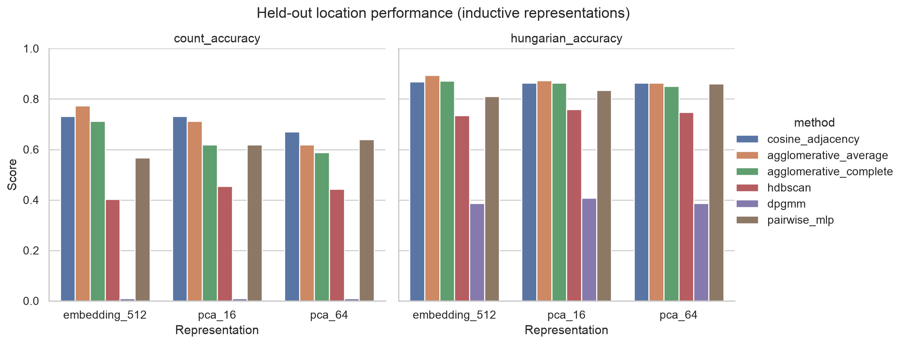

# Birdcount: counting individual Ovenbirds from call embeddings

This repository investigates whether repeated Ovenbird vocalizations in an audio recording can be grouped by individual identity and converted into an estimated number of birds.

The current workflow starts from annotated calls, extracts a 512-dimensional embedding for each two-second audio window, clusters calls independently within each recording, and evaluates both the resulting individual count and the recovered call-to-individual assignments.

The main experiment is in [`analysis-notebook.ipynb`](analysis-notebook.ipynb). It has been executed and contains the result tables and visualizations described below.

## Current result

The best inductive configuration on held-out locations is **average-linkage agglomerative clustering on the original 512-dimensional embeddings**, using a cosine-distance threshold of **0.25**.

| Metric | Constant one-individual baseline | Best model |
|---|---:|---:|
| Exact count accuracy | 52.6% | **77.3%** |
| Count mean absolute error | 0.619 | **0.247** |
| Hungarian-matched assignment accuracy | 79.9% | **89.4%** |

Relative to always predicting one individual, the best model reduces count MAE by **60%** and improves exact-count accuracy by **24.7 percentage points**.



## Data and embeddings

The embedding dataset was constructed from manually annotated Ovenbird calls:

- 1,174 annotation rows were supplied.
- 1,149 calls had matching audio and were embedded.
- 25 rows were retained in the metadata but marked `missing_audio`.
- Each call is represented by a 512-dimensional `float32` embedding.
- Embeddings cover 284 locations and 298 recordings.
- Every model input is a two-second window centered on the annotated call and clamped to the recording boundaries when necessary.

The aligned files are:

- `outputs/ovenbird_embeddings/ovenbird_embeddings.npy`: the embedding matrix.
- `outputs/ovenbird_embeddings/ovenbird_embedding_metadata.csv`: annotations and the corresponding `embedding_row` indices.
- `outputs/ovenbird_embeddings/ovenbird_embedding_manifest.json`: input hashes, model checkpoint, package versions, windowing rules, and generation details.

Embedding extraction is implemented in [`ovenbird-individual-recognition/embed_annotated_calls.py`](ovenbird-individual-recognition/embed_annotated_calls.py). The script uses the trained Ovenbird feature extractor under `ovenbird-individual-recognition/` and does not rerun species detection.

## Experimental design

### Unit of clustering

Calls are clustered **within each recording**. A cluster represents one predicted individual, so the predicted count is the number of clusters in that recording.

Recordings containing only one usable call are excluded from the benchmark because every method must predict exactly one individual for them. This leaves:

- 131 eligible recordings in the development partition.
- 97 eligible recordings in the test partition.

Ground-truth counts are computed as the number of unique `individual_order` labels rather than their maximum value.

### Location-held-out split

Locations, not individual calls, are divided into a reproducible 60/40 development-test split:

- Development: 689 calls from 60% of locations.
- Test: 460 calls from the remaining 40% of locations.

No location occurs in both partitions. The development data is used for hyperparameter selection and pairwise-MLP training. The test locations remain untouched until the selected configurations are evaluated.

The partition is called *development*, rather than validation, because it is also training data for the supervised MLP.

## Representations

Five representations are evaluated:

| Representation | Dimensions | Evaluation regime | Notes |
|---|---:|---|---|
| Original embedding | 512 | Inductive | No dimensionality reduction |
| PCA | 16 | Inductive | Fitted only on development calls; retains 75.6% of development variance |
| PCA | 64 | Inductive | Fitted only on development calls; retains 94.2% of development variance |
| t-SNE | 5 | Transductive/exploratory | Fitted jointly because scikit-learn t-SNE has no `transform()` |
| t-SNE | 16 | Transductive/exploratory | Fitted jointly and reported separately |

t-SNE is not designed to preserve global distances and does not provide a standard out-of-sample transformation. Its results are retained as an exploratory comparison but are not used for the primary conclusion.

## Counting methods

### Thresholded cosine graph

Cosine similarity is calculated for every pair of calls in a recording. Pairs above the selected similarity threshold form edges in an adjacency graph, and connected components become predicted individuals.

Similarity thresholds from 0.50 through 0.95 are tuned on the development locations.

### Agglomerative hierarchical clustering

Calls begin as separate clusters and are merged while their cosine distance is below a threshold. Two linkage rules are compared:

- **Average linkage:** uses the average pairwise distance between clusters.
- **Complete linkage:** uses the largest pairwise distance between clusters and is therefore more conservative at a fixed threshold.

The current experiment searches cosine-distance thresholds from 0.05 through 0.50. The original 512-dimensional embeddings select an interior optimum: 0.25 for average linkage and 0.35 for complete linkage.

Both PCA representations reach the upper search boundary. PCA centers and rotates the embeddings, changing the cosine-distance scale; therefore, the PCA linkage results should be considered provisional until the threshold grid is extended beyond 0.50.

### HDBSCAN

HDBSCAN is evaluated with `min_cluster_size=2` and `min_samples` values of 1 and 2. A minimum cluster size of one is not defined by the implementation. Calls labeled as HDBSCAN noise are treated as singleton individuals so that every call contributes to the count.

### Dirichlet-process Gaussian mixture

`BayesianGaussianMixture` supplies a finite truncation of a Dirichlet-process Gaussian mixture model with diagonal covariance. Each recording can use up to one component per call, and concentration priors of 0.01, 0.1, 1.0, and 10.0 are compared.

This method is intended to let the number of occupied components adapt to the recording while representing mixture uncertainty. In the present small, high-dimensional recording groups it tends to over-segment the calls and performs poorly.

### Pairwise MLP

The supervised pairwise model predicts whether two calls are from the same bird. Its symmetric input is

```text
concat(abs(embedding_a - embedding_b), embedding_a * embedding_b)
```

The architecture is:

```text
pair features
    -> standardization
    -> dense 64, ReLU
    -> dense 16, ReLU
    -> binary probability
```

It is trained with balanced positive and negative pairs, binary cross-entropy/log loss, Adam, L2 regularization of 0.001, and early stopping with a 20% internal validation fraction. Pair probabilities are thresholded to construct an adjacency graph, and connected components become individuals. Probability thresholds from 0.50 through 0.95 are selected on the development data.

The input contains 1,024 features for the original embeddings, 32 for PCA-16, and 128 for PCA-64.

## Evaluation metrics

Metrics are first calculated for each recording and then macro-averaged so that recordings with many calls do not dominate.

- **Exact count accuracy:** fraction of recordings for which the predicted number of individuals equals the annotated count.
- **Count MAE:** mean absolute difference between predicted and annotated individual counts.
- **Hungarian-matched accuracy:** call-level clustering accuracy after optimally matching arbitrary predicted cluster IDs to annotated individual IDs with the Hungarian algorithm.

Hyperparameters are selected lexicographically by development Hungarian accuracy, then exact count accuracy, then lower count MAE.

## Held-out results

The table below shows the best inductive representation for each method, selected by Hungarian accuracy. All values are from the same 97 held-out recordings.

| Method | Best representation | Selected setting | Count accuracy | Count MAE | Hungarian accuracy |
|---|---|---|---:|---:|---:|
| Agglomerative, average | Original 512-D | distance 0.25 | **77.3%** | **0.247** | **89.4%** |
| Agglomerative, complete | Original 512-D | distance 0.35 | 71.1% | 0.309 | 87.1% |
| Cosine adjacency | Original 512-D | similarity 0.80 | 73.2% | 0.371 | 86.8% |
| Pairwise MLP | PCA-64 | probability 0.50 | 63.9% | 0.412 | 86.0% |
| HDBSCAN | PCA-16 | cluster size 2, samples 1 | 45.4% | 0.742 | 75.8% |
| Dirichlet-process GMM | PCA-16 | prior 0.01 | 1.0% | 2.753 | 40.8% |

PCA-64 retains more total variance than PCA-16 but does not outperform the original embeddings. Retaining variance is not equivalent to retaining the identity-discriminative geometry needed by the clustering methods.

Additional figures include:

- `outputs/individual_counting_experiment/figures/hungarian_accuracy_heatmap.png`
- `outputs/individual_counting_experiment/figures/development_threshold_sensitivity.png`
- `outputs/individual_counting_experiment/figures/best_model_true_vs_predicted_count.png`

Machine-readable outputs include:

- `development_grid_results.csv`: every development-set hyperparameter trial.
- `selected_configurations.csv`: the selected setting for each method and representation.
- `test_summary_results.csv`: held-out macro metrics.
- `test_recording_results.csv`: recording-level held-out predictions and metrics.
- `inductive_test_metric_table.csv`: compact inductive comparison table.

All are stored in `outputs/individual_counting_experiment/`.

## Repository structure

```text
.
├── analysis-notebook.ipynb
├── individual_counting_experiment.py
├── scripts/
│   └── build_analysis_notebook.py
├── outputs/
│   ├── ovenbird_embeddings/
│   └── individual_counting_experiment/
└── ovenbird-individual-recognition/
    ├── embed_annotated_calls.py
    ├── src/
    ├── checkpoints/
    └── requirements.txt
```

[`individual_counting_experiment.py`](individual_counting_experiment.py) contains the reusable splitting, clustering, MLP, and metric functions. [`scripts/build_analysis_notebook.py`](scripts/build_analysis_notebook.py) builds the notebook deterministically from its source cells.

## Reproducing the experiment

Run commands from the repository root.

### 1. Create an environment

The full feature-extraction environment can be installed from the original project requirements:

```bash
python -m venv .venv
source .venv/bin/activate
pip install -r ovenbird-individual-recognition/requirements.txt
pip install jupyter nbformat
```

The counting experiment requires NumPy, pandas, SciPy, scikit-learn, Matplotlib, seaborn, Jupyter, and nbformat. The embedding step additionally requires PyTorch, OpenSoundscape, the model code, and its checkpoint.

### 2. Generate embeddings when needed

If the aligned embedding outputs are not already present:

```bash
python ovenbird-individual-recognition/embed_annotated_calls.py \
  path/to/OvenbirdIndividualAnnotations.csv \
  Recordings \
  outputs/ovenbird_embeddings
```

The trained checkpoint is expected under `ovenbird-individual-recognition/checkpoints/`.

### 3. Rebuild and execute the notebook

```bash
python scripts/build_analysis_notebook.py
jupyter nbconvert \
  --to notebook \
  --execute analysis-notebook.ipynb \
  --inplace \
  --ExecutePreprocessor.timeout=120
```

Executing the notebook overwrites the CSV tables and figures in `outputs/individual_counting_experiment/`.

## Current limitations and next experiments

- Extend the agglomerative distance grid for PCA-16 and PCA-64. Their selected value of 0.50 is the current upper boundary, unlike the interior optimum found for the original embeddings.
- Add repeated location-grouped splits or grouped cross-validation to quantify uncertainty around the single 60/40 split.
- Report confidence intervals, not only point estimates, using location- or recording-level bootstrap resampling.
- Investigate calibration and alternative graph construction for the pairwise MLP. Connected components can amplify one false-positive edge into an incorrect merge.
- Consider metric learning or a contrastive objective designed specifically for same-individual separation.
- Evaluate robustness as the number of calls and true individuals per recording changes.
- Keep t-SNE results exploratory; use an out-of-sample-capable reduction such as PCA or UMAP for a fair inductive benchmark.

## Provenance

The embedding manifest records the source annotation hash, model-checkpoint hash, package versions, extraction device, and windowing parameters. Results reported here correspond to the executed notebook and CSV outputs currently stored in the repository.
